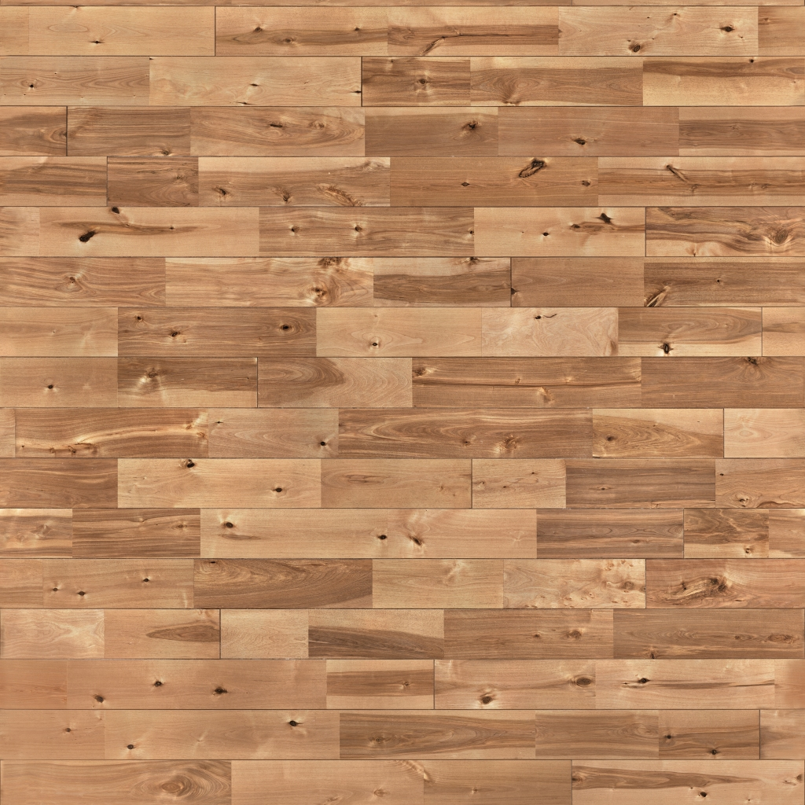
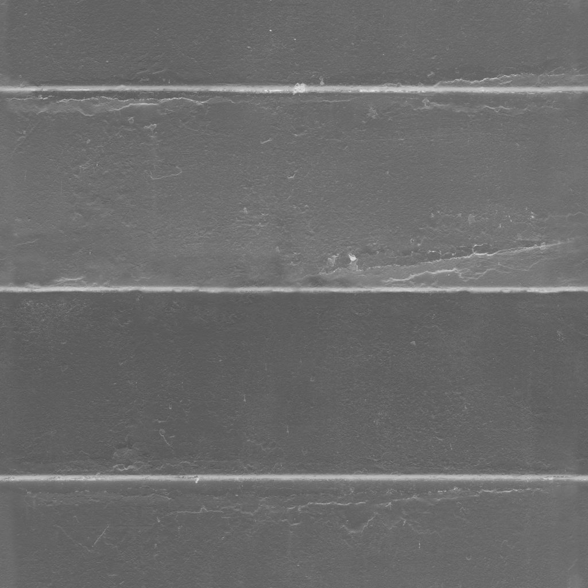
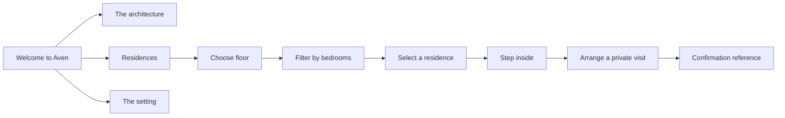
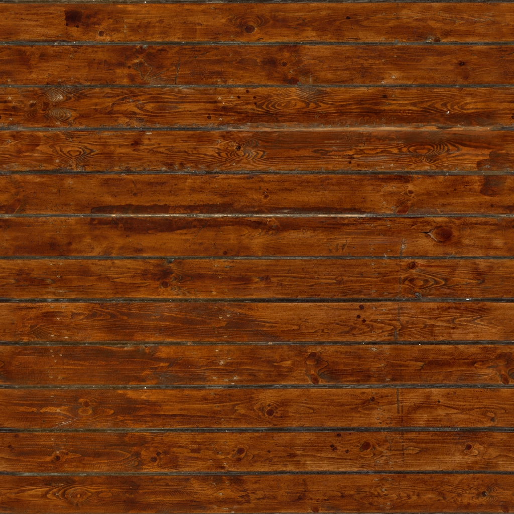
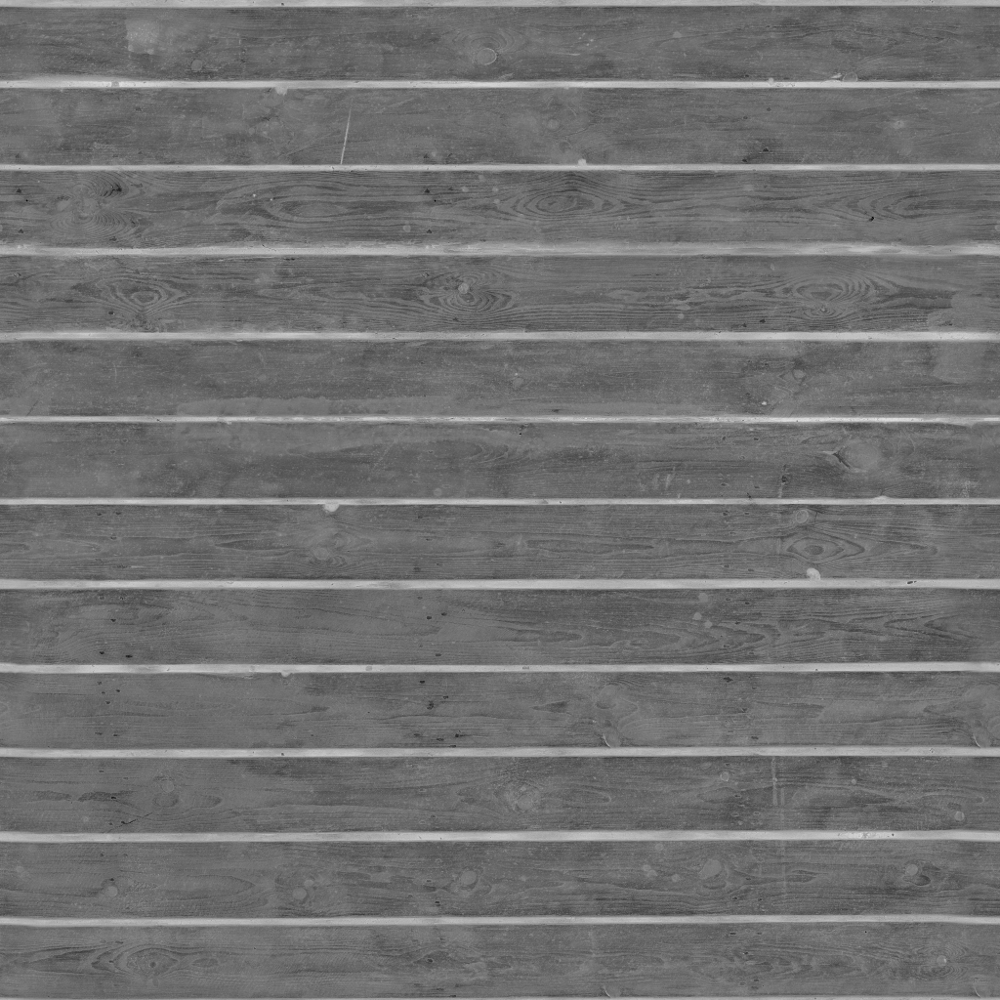
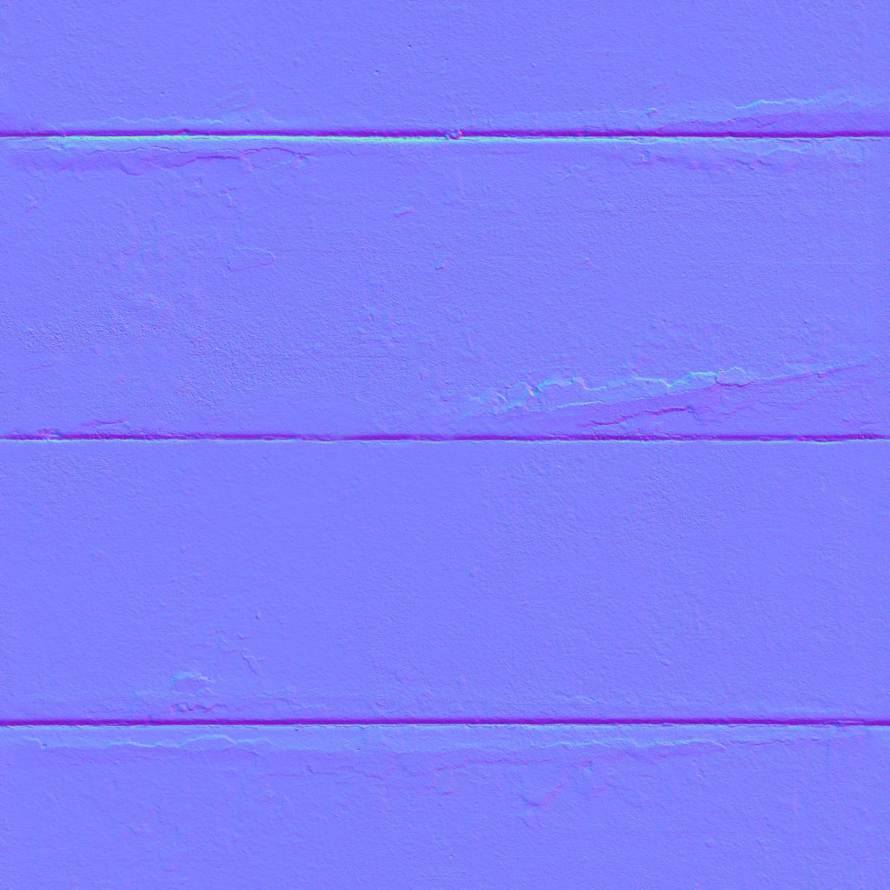

# Aven Residences

<p align="center">
  
</p>

<h3 align="center">A considered address in Lagos.</h3>

<p align="center">
  An immersive real-estate experience for exploring Aven's architecture, residences, materials, and setting.
</p>

<p align="center">
  <a href="#getting-started">Run locally</a> ·
  <a href="#experience-map">Explore the experience</a> ·
  <a href="#project-structure">Project structure</a>
</p>

---

## The experience

Aven is a cinematic property showcase built around one idea: **the building is the interface**.

Instead of presenting a conventional catalogue of property cards, the site lets visitors move through a real-time 3D representation of the development. The interface stays quiet and editorial while the architecture carries the visual weight.

<p align="center">
  
  
  
</p>

<p align="center"><em>Warm timber, tactile stone, and soft interior finishes establish the material language.</em></p>

## Experience map



### Discover

- Rotate through **south-west**, **south elevation**, and **south-east** views.
- Switch the atmosphere between **day** and **dusk**.
- Enter full-screen mode for a more immersive architectural read.
- Move through the architecture, landscaped arrival, terraces, and surrounding city.

### Find a home

- Browse all **32 residences** across **eight residential levels**.
- Select a floor to highlight its position in the building.
- Filter by one, two, or three bedrooms using a custom Aven-styled dropdown.
- Preview availability, area, terrace size, price, and residence name.
- Step into a furnished apartment cutaway for a closer look.

### Take the next step

- Open the private-viewing dialog from the main experience or a selected apartment.
- Choose a preferred viewing date.
- Submit contact details to the enquiry route.
- Receive a confirmation state with a reference number.

## Visual language

| Layer | Direction |
| --- | --- |
| **Palette** | Deep slate blue, warm ivory, muted stone, and amber highlights |
| **Typography** | Manrope Variable, used for a calm editorial rhythm |
| **Motion** | Subtle entrance reveals, camera movement, hover feedback, and atmosphere changes |
| **Materials** | Locally bundled PBR textures for timber, stone, concrete, fabric, and lighting |
| **Controls** | Flat, tactile controls with amber focus and selection states |
| **Fallback** | A readable experience remains available when WebGL cannot start |

<p align="center">
  
  
  
  
</p>

## Technical foundation

- **Next.js 16** with the App Router
- **React 19**
- **TypeScript**
- **React Three Fiber** and **Three.js** for the interactive scene
- **Drei** for 3D helpers and HTML overlays
- **GSAP** for interface reveal motion
- **Tailwind CSS 4** through the PostCSS integration
- A small **Next.js API route** for viewing enquiries

The scene is authored in code rather than loaded from an external 3D service. The building, streetscape, furniture, trees, and apartment interiors are project-owned geometry and remain available when the site runs without external asset requests.

## Project structure

```text
.
├── app/
│   ├── api/enquiries/       Viewing enquiry endpoint
│   ├── globals.css          Global tokens, layout, controls, and responsive styling
│   ├── layout.tsx           Metadata, font, and application shell
│   ├── not-found.tsx        Branded 404 experience
│   └── page.tsx             Main Aven entry point
├── components/
│   ├── Experience.tsx       Main experience state and UI orchestration
│   ├── Scene.tsx            React Three Fiber scene and camera
│   ├── Architecture.tsx     Building, facade, trees, and streetscape
│   ├── Apartment.tsx        Furnished apartment cutaway
│   ├── Furniture.tsx        Reusable interior geometry
│   ├── Materials.tsx        Bundled PBR material loading
│   └── City.tsx             Background city atmosphere
├── lib/
│   ├── architecture.ts      Building geometry data
│   ├── city.ts              City and streetscape data
│   ├── enquiries.ts         Enquiry validation and normalization
│   └── residences.ts        Residence catalogue and filters
├── public/
│   ├── fonts/               Manrope Variable and license
│   ├── materials/           Bundled textures, HDR lighting, and credits
│   └── icon.svg             Aven favicon and mark
└── tests/
    └── residences.test.ts   Catalogue, validation, and geometry tests
```

## Getting started

### Requirements

- Node.js 22+
- npm

### Install and run

```bash
npm install
npm run dev
```

Open [http://localhost:3000](http://localhost:3000).

### Available scripts

| Command | Purpose |
| --- | --- |
| `npm run dev` | Start the local development server on port 3000 |
| `npm run build` | Create the optimized production build |
| `npm run start` | Serve the production build |
| `npm run check` | Run the TypeScript compiler without emitting files |
| `npm test` | Run the Node test suite |

## Content and data

The current catalogue is intentionally small and legible:

- 32 selectable homes
- Floors 1–8
- One, two, and three-bedroom layouts
- Area and terrace dimensions
- Availability states
- Residence names and indicative pricing

Property content lives in [`lib/residences.ts`](./lib/residences.ts), making it straightforward to replace the preview catalogue with a connected CMS, database, or API later.

## Accessibility and resilience

- Semantic headings, labels, buttons, dialogs, and navigation landmarks
- Visible keyboard focus states
- Escape and outside-click dismissal for custom menus and dialogs
- Reduced-motion preference detection
- WebGL error boundary with a readable fallback
- No-script message for visitors without JavaScript
- Branded 404 page for missing routes

## Materials and credits

All downloaded PBR assets are bundled locally. They are CC0 assets from Poly Haven; their source pages and creators are listed in [`public/materials/CREDITS.md`](./public/materials/CREDITS.md).

The architecture and furniture geometry are authored in the project. No external 3D hosting is required at runtime.

## Deployment note

If deploying the repository from a parent folder, set the Vercel **Root Directory** to:

```text
Real Estate website
```

This matters because the project directory contains a space. Deploying from the parent directory can cause Vercel to generate an invalid serverless function name.

## Preview checklist

Before launch, verify:

- Replace any sample residence names, dimensions, and indicative prices with approved sales data.
- Connect the enquiry route to the production sales workflow or CRM.
- Confirm the Lagos address and contact details.
- Test the 3D scene on a lower-powered mobile device.
- Test the private-viewing flow with production validation and notification handling.

---

<p align="center">
  <strong>Aven residences</strong><br>
  <em>Space to breathe. Room to belong.</em>
</p>
